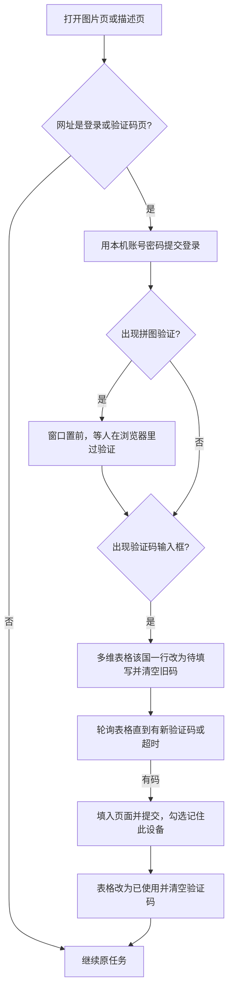

# Amazon 跨站图片上传 设计文档

本文描述本机程序 **Amazon 跨站图片上传**（仓库 `amz-piggyback-im`）的目标、与 CL 的分工、两条后台操作，以及任务、重试、告警和日志。后台点击顺序以[亚马逊后台上传站点图片+提交应用 A+](https://aosom.feishu.cn/wiki/KXnEwlzFgijD4pkhpHacUG0GnTh)为准。实现进度以代码为准，见第 11 节。

**本期登录**：人工保证各国 Chrome 已登录卖家后台。半自动重登见 **附录 A（TODO，未实施）**。

## 1. 目标

在 Windows 本机，用已登录的 Chrome，按**跨站国别**完成两件事：

1. **传站点图**：把上游给出的图片上传到 Seller Central 图片管理页。
2. **A+ 提交应用**：找到类型为 EBC、状态为草稿的 A+，确认已应用 ASIN 后提交批准；**无此类草稿则跳过 A+**，不算失败。

CL 负责欧洲五国跟卖上架，以及在规定时机触发本程序。本程序不实现上架，只执行上传和提交，并把结果写回 CL 任务行。程序能力覆盖七国（含 US/CA）；CL 现阶段主要投欧洲五国。

## 2. 范围

| 侧 | 做 | 不做 |
|---|---|---|
| CL | 欧洲五国跟卖上架（与北美同一套逻辑）；在两个时机插入任务行；按任务行终态展示结果 | 不操作 Seller Central 页面 |
| 本程序 | 轮询领取、下载图片、按跨站国别上传站点图、提交 A+、本机重试、记日志、终态写回 CL；登录失效时暂停该国并飞书告警 | 不创建 Listing，不删除后台图片，不上传 FRONT / SIDE / BACK；本期不做半自动重登 |

国家站点与现有调试端口一致：US `9222`、CA `9223`、UK `9224`、DE `9225`、FR `9226`、IT `9227`、ES `9228`。欧洲五国指 UK、DE、FR、IT、ES。

`错误边界.md` 暂时保留作历史参考；**与本文冲突时以本文为准**。

## 3. 运行形态

程序跑在操作员的 Windows 本机，不是 Linux 服务。

- 每个国家使用独立 Chrome 用户目录和调试端口，调试地址只绑定 `127.0.0.1`。
- 浏览器控制只用 Chrome DevTools Protocol。上传用 `DOM.setFileInputFiles`，不弹出系统文件框。
- Chrome 与本程序必须在同一台机器。
- **本期**：Seller Central 登录与验证码由人工在该 Chrome 中完成。检测到登录墙或登录失败时：不执行该国任务，发飞书告警，每 30 分钟自动监控直至恢复（见第 9.3 节）。半自动重登见附录 A。
- 正式通道是 CL 库 **`cadev`** 表 `ca_pid_amz_cross_site_task_all`。CL 插入一行，本机轮询领取，终态写回同一行。CL 服务器不连接本机 `127.0.0.1`。
- 库连接：公开项在 `config/settings.json` 的 `cl_db`（表名、轮询间隔等）；**host / user / password 只放** `config/settings.local.json`（已 gitignore，仓库仅有 `.example`）。程序启动时 `load_config` 会合并二者。打包时不要把 `settings.local.json` 打进发行包。
- 本程序只连 **cadev**（正式站），不连 catest。对 cadev 的写操作须经用户当次明确允许后再执行；开发联调默认只读或先确认。

Excel 选择/拖入只保留为联调入口，不作为自动触发通道。

## 4. 总流程

```text
CL 在触发点 INSERT 一行（TASK_STATUS = New，ACTIONS / IMAGES 等已填）
  → 本机轮询 New，CAS 领取为 Process，刷新 UPDATED_DATE
  → 入队校验（空字段等）不通过 → Error + ERROR_*，结束
  → 复制到本机 SQLite 后执行
  → 按 CROSS_COUNTRY 连接已登录 Chrome
  → 传站点图（按 IMAGES 下载完整 URL）
  → 再执行 A+：有 EBC 草稿则提交；无草稿则跳过 A+（不算失败）
  → 站点图成功且（A+ 成功或已跳过）→ Confirm，清空 ERROR_*
  → 可重试失败 → CL 保持 Process，本机待重试；耗尽或不可重试 → Error
```

**默认每条任务都执行传站点图与 A+**（先图后 A+）。无 EBC+草稿时跳过 A+，只要站点图成功即可 `Confirm`。A+ 不依赖本次站点图已经通过亚马逊审核。亚马逊审核是后台异步结果，RPA 不等待「已显示」或前台可见。

## 5. 任务

### 5.1 CL 表 `ca_pid_amz_cross_site_task_all`

正式通道采用 **CL 任务表轮询**。执行过程以本机 SQLite 为准，终态写回该表同一行。

#### 现有列（以库表为准）

| 列 | 含义 |
|---|---|
| `AMZ_CROSS_TASK_GUID` | 主键 |
| `ORG_UNITS_GUID` | 国别 GUID（历史字段；**本机定位国家不依赖此列**） |
| `CURRENT_SHOP_GUID` / `CURRENT_SHOP_NAME` | 当前跨站店铺 |
| `SKU` / `ASIN` | 货号 / LISTED_ID |
| `MAIN_SHOP_GUID` / `MAIN_SHOP_NAME` | 主站店铺 |
| `TASK_ID` | 关联 `ca_pid_common_task_all.TASK_GUID`，唯一 |
| `IMAGES` | 图片地址 JSON 数组（**完整 URL**） |
| `ERROR_CODE` / `ERROR_MESSAGE` | 本机回写 |
| `TASK_STATUS` | 见下；默认 `New` |
| `ACTIONS` | JSON 数组字符串，**由 CL 写入**，本机只读 |
| `CREATION_DATE` | 写入时间 |

#### CL 需增补的列

| 列 | 含义 |
|---|---|
| `MAIN_COUNTRY` | 主站国别代码：`US` `CA` `UK` `DE` `FR` `IT` `ES` |
| `CROSS_COUNTRY` | 跨站国别代码（同上）。**本机只认此二字段定位跨站与 Chrome**，不认 `ORG_UNITS_GUID` |
| `UPDATED_DATE` | 最后更新时间。领取、执行中心跳、开始重试、回写时刷新；用于僵尸 `Process` 回收 |

#### `TASK_STATUS`

| 状态 | 含义 |
|---|---|
| `New` | 可领取 |
| `Process` | 已领取，执行中（含本机可重试等待期间） |
| `Confirm` | 整单成功：站点图成功，且 A+ 成功或因无草稿已跳过 |
| `Error` | 终态失败（不可重试，或本机重试耗尽） |

领取（防重复消费）：

```sql
UPDATE ca_pid_amz_cross_site_task_all
SET TASK_STATUS = 'Process', UPDATED_DATE = NOW()
WHERE AMZ_CROSS_TASK_GUID = :id AND TASK_STATUS = 'New'
```

更新行数为 1 才算领到。领到后复制进本机 SQLite，再打开浏览器。

终态回写：

- 成功：`TASK_STATUS = Confirm`，清空 `ERROR_CODE`、`ERROR_MESSAGE`，刷新 `UPDATED_DATE`。
- 终态失败：`TASK_STATUS = Error`，写入 `ERROR_CODE`、`ERROR_MESSAGE`，刷新 `UPDATED_DATE`。
- 可重试中：CL **保持 `Process`**，可把最近一次错误写在 `ERROR_*` 上；本机状态为 `待重试`。不改回 `New`，避免被其他实例抢走。

僵尸 `Process` 回收（与登录监控同节奏，默认 **30 分钟**）：

```sql
UPDATE ca_pid_amz_cross_site_task_all
SET TASK_STATUS = 'New', UPDATED_DATE = NOW()
WHERE TASK_STATUS = 'Process'
  AND UPDATED_DATE < NOW() - INTERVAL 30 MINUTE
```

长任务（多图上传等）执行中应定期刷新 `UPDATED_DATE`（心跳），避免误回收导致双实例同跑。开始下一次重试时也刷新一次。配置项：`stale_processing_seconds`（默认 1800）。轮询只领取 `New`。

本机不写 `ACTIONS`。不设 CL 侧 `trigger`、`site_image_status`、`attempt`、`worker_id` 列；重试次数与分步状态只在本机 SQLite。上架页若需展示站点图结果，由 CL 根据本行 `Confirm` / `Error` 及 `ERROR_*` 自行同步，本程序不再单独回写站点图状态字段。

未采用的通道：共享 Excel（仅联调）、CL HTTP 拉取/回写（本机不能持库账号时再议）、CL 调本机 HTTP。

### 5.2 CL 何时触发

| 触发 | 条件 | 本程序执行 |
|---|---|---|
| 上架完成 | 帖子状态变为 **Listed(A+已上传)** | 传站点图，再 A+（无草稿则跳过 A+） |
| 图片更新 | 正常图片或 AI 打标图片发生更新 | 同上：传站点图，再 A+（无草稿则跳过 A+） |

两种触发步骤相同。CL 写入的 `ACTIONS` 建议均为 `["site_images", "aplus"]`；本机**默认按「传图 + A+」执行**，不以「仅 site_images」省略 A+。无草稿时的跳过见第 7 节。

### 5.3 任务字段规则

逻辑字段与表列对应：`TASK_ID`、`SKU`、`ASIN`、`MAIN_COUNTRY`、`CROSS_COUNTRY`、`ACTIONS`、`IMAGES`。

| 字段 | 规则 |
|---|---|
| `TASK_ID` / `AMZ_CROSS_TASK_GUID` | 日志与告警**两者都打** |
| `SKU` / `ASIN` | 搜索关键词：有 SKU 用 SKU，否则用 ASIN。二者都空 → 入队失败 |
| `CROSS_COUNTRY` | 连接该国 Chrome、打开该国 Seller Central。无法识别 → 入队失败 |
| `MAIN_COUNTRY` | 与跨站定位一并由 CL 填写；本机用于校验/日志，连浏览器以 `CROSS_COUNTRY` 为准 |
| `ACTIONS` | CL 建议写入 `["site_images", "aplus"]`。本机默认两步都做；须有有效 `IMAGES`，且须有非空 `ASIN`（供 A+ 比对；无草稿跳过 A+ 时仍要求入队时 ASIN 非空） |
| `IMAGES` | JSON 数组，**每一项为完整 `http(s)` URL**（参考既有 CDN 示例）。按展示顺序：`[0]`→MAIN，`[1]`→PT01，以此类推 |

`IMAGES` 示例：

```json
[
  "https://img-cl.aosomcdn.com/icxjbZdPQoOz4_HddQDT4BP0guvZHi9Lye2ZjuJO9TEaosomicxjbZdPQoOz4_HddQDT4BP0guvZHi9Lye2ZjuJO9TE.jpg"
]
```

同一 `TASK_ID` 再次变为可执行时不新增业务含义上的新任务：本机按 `TASK_ID` 合并，**已成功的站点图跳过，只重跑未成功步骤**（例如仅 `aplus`）。

### 5.4 入队校验（不可重试，直接 `Error`）

不依赖上游「一定传对」；空值用专用 `ERROR_CODE`，不用笼统的 `TASK_INVALID`。

| 情况 | ERROR_CODE |
|---|---|
| `TASK_ID` 为空 | `TASK_ID_EMPTY` |
| `MAIN_COUNTRY` / `CROSS_COUNTRY` 无法识别为七国代码 | `COUNTRY_INVALID` |
| `SKU`、`ASIN` 都空 | `SKU_ASIN_EMPTY` |
| `IMAGES` 缺省或空数组 | `IMG_EMPTY` |
| `IMAGES` 某项为 null / 空串 / 纯空白 | `IMG_ITEM_EMPTY`（`ERROR_MESSAGE` 带下标） |
| `IMAGES` 某项不是 `http://` 或 `https://` 开头 | `IMG_URL_INVALID` |
| `ASIN` 空（默认要走 A+ 比对） | `ASIN_EMPTY` |

缺 `ASIN`：**入队即拦截**，不先传站点图。`ACTIONS` 缺省或无法解析时按默认 `["site_images", "aplus"]` 处理，不因此 `Error`。

### 5.5 本机队列

在现有 `data/queue.sqlite3` 上扩展。

`task` 保存当前态：

| 列 | 含义 |
|---|---|
| `id` | 本机主键 |
| `task_id` | `TASK_ID`，唯一 |
| `amz_cross_task_guid` | `AMZ_CROSS_TASK_GUID` |
| `sku` / `asin` | 同 CL |
| `main_country` / `cross_country` | 同 CL |
| `actions` / `images` | JSON，保留原始值 |
| `status` | 见下表 |
| `attempt` | 已执行次数，从 1 开始（只在本机） |
| `error_code` / `error_msg` | 最近一次失败 |
| `site_image_status` | `未执行` / `成功` / `失败` |
| `aplus_status` | `未执行` / `成功` / `失败` / `跳过`（无 EBC 草稿） |
| `created_at` / `updated_at` | 本机时间 |

`task_attempt` 追加每次尝试：`task_id`、`attempt`、`action`（`site_images` 或 `aplus`）、`error_code`、`error_msg`、`detail`、`created_at`。

| 本机 status | 含义 |
|---|---|
| `待处理` | 已入队，尚未开始 |
| `处理中` | 正在执行 |
| `待重试` | 本次失败且未到上限 |
| `成功` | 对应 CL `Confirm` |
| `失败` | 对应 CL `Error` |
| `待人工` | 该国登录不可用，暂停（见第 9.3 节） |

英国、德国、法国、意大利、西班牙各一条线程，每国同时只跑一条。进程退出时，本机 `处理中` 下次启动改为 `待重试`。CL 侧若仍为 `Process` 且未过期，由本机继续；若已被回收为 `New`，再 CAS 领取后按 `TASK_ID` 合并 attempt 与分步状态。

## 6. 传站点图

按 `CROSS_COUNTRY` 打开：`https://<该国 Seller Central 域名>/imaging/manage`。

1. 直接打开 `/imaging/manage`，不点菜单。
2. 搜索关键词并回车。结果必须恰好 1 个商品，且该行 SKU 或 ASIN 与关键词一致。
3. 滚到国家模块 `ou-section-{CROSS_COUNTRY}`。
4. 按 `IMAGES` 顺序逐位上传。
5. 每一位看到上传成功标志才算成功；文件路径进入文件框不算成功。

| `IMAGES` 下标 | 页面位置 |
|---|---|
| 0 | MAIN |
| 1–7 | PT01–PT07 |
| 8 起 | PT08、PT09…（上一位成功后再等新位出现） |

不上传 FRONT / SIDE / BACK。

下载到任务工作目录，文件名按 `MAIN`、`01`、`02`…，扩展名取自 URL。允许：`.gif` `.pjp` `.jfif` `.jpe` `.pjpeg` `.jpeg` `.jpg` `.png`。

整单站点图成功：`IMAGES` 每一张都在对应位置确认成功。任一下载失败、找不到位置或未确认成功 → 站点图失败，后续位不再传。已成功位写入 `task_attempt.detail`。

不把亚马逊稍后的「已显示」当作 RPA 成功。成功标志：该位出现新图、位置名固定、出现等待审核图标。

**已有图替换**：逐位往该位文件框覆盖上传，不点「全部替换」，也不先删原图。

图片更新再次触发时，仍按 `IMAGES` 全量顺序上传。

## 7. 提交 A+

**默认每条任务在站点图之后都执行 A+。** 站点图失败则不再做 A+，整单按站点图错误结束。

1. 打开该国「管理 A+ 商品描述」。
2. 用同一关键词搜索。
3. 在结果中筛选类型 **EBC**、状态 **草稿**：
   - **0 条（无草稿）** → **跳过 A+**：本机 `aplus_status = 跳过`，记一条 `task_attempt`（说明无草稿），**不**写 CL `Error`；若站点图已成功则整单 `Confirm`
   - **多条** → 取列表**从上到下第一条**
4. 进入该条 → 编辑 →「下一步: 应用 ASIN」。已应用 ASIN 必须等于任务 `ASIN`，否则 `APLUS_ASIN_MISMATCH`。
5. 「下一步: 查看并提交」→「提交以供批准」→ 弹窗再确认。
6. 提示成功且状态为 **已提交** → A+ 成功（`aplus_status = 成功`）。

已进入某条草稿后，提交过程失败仍按第 9.2 节可重试/不可重试处理；与「根本没有草稿因而跳过」不同。

A+ 选择器实现前先从已登录页核对再写死常量。

重试时：若本机 `site_image_status = 成功`，**跳过站点图，只重跑 aplus**（若上次为跳过且仍无草稿，再次跳过即可）。

## 8. 回写 CL

回写同一行，至少：

| 场景 | TASK_STATUS | ERROR_CODE / ERROR_MESSAGE | UPDATED_DATE |
|---|---|---|---|
| 整单成功（含 A+ 已跳过） | `Confirm` | 清空 | 刷新 |
| 终态失败 | `Error` | 写入 | 刷新 |
| 可重试中 | 保持 `Process` | 可写入最近一次 | 刷新（含心跳） |

不再回写独立的 `site_image_status` 列。A+ **业务失败**（非「无草稿跳过」）时 `ERROR_*` 对应步骤为 `aplus`（详情见本机 `task_attempt` 与日志）。无草稿跳过不写 `ERROR_*`。

## 9. 异常、重试与告警

### 9.1 重试

配置 `max_attempts`，默认 **3**。按整单计次；同一次执行里站点图失败记 1 次，不再接着做 A+。

可重试期间：本机 `待重试`，CL 保持 `Process`。达到上限或不可重试 → 本机 `失败`，CL `Error`。没有草稿仍是跳过，不记成出错。

### 9.2 errorCode

可重试（未到 N 次则本机 `待重试`，否则 CL `Error`）：

| errorCode | 场景 |
|---|---|
| `BROWSER_CONNECT_FAILED` | 连不上该国调试端口，或端口没有可控制页面 |
| `PAGE_NOT_READY` | 图片管理页或 A+ 页面导航、就绪超时 |
| `IMG_DOWNLOAD_FAILED` | 图片下载失败、超时或 HTTP 非成功 |
| `IMG_SEARCH_TIMEOUT` | 搜索结果未在时限内变成 1 条匹配商品 |
| `IMG_SLOT_FAILED` | 某一位找不到、不唯一，或上传后没有成功标志 |
| `APLUS_SEARCH_TIMEOUT` | A+ 搜索结果未在时限内就绪 |
| `APLUS_SUBMIT_FAILED` | 提交过程超时，或提交后状态没有变成已提交 |
| `UNKNOWN` | 未归类异常 |

不可重试（立刻 CL `Error`）：

| errorCode | 场景 |
|---|---|
| 第 5.4 节入队校验各码 | 空字段、URL 非法等 |
| `IMG_SEARCH_NOT_UNIQUE` | 搜索结果不是 1 件，或唯一一件与关键词不一致 |
| `IMG_TYPE_UNSUPPORTED` | 扩展名不在允许列表 |
| `APLUS_ASIN_MISMATCH` | 已应用 ASIN 不是目标 |

无 EBC+草稿 → **跳过 A+**，不用 `APLUS_NOT_FOUND` / `APLUS_NOT_EBC` / `APLUS_NOT_DRAFT` 打成 `Error`。

业务失败**只写回 CL 任务行**，不发飞书。

### 9.3 登录失效：暂停该国 + 飞书告警

仅以下情况发飞书机器人告警（业务终态失败不发）：

- 导航落在登录墙 / 登录态失效
- 密码被拒、验证码超时、需 App 批准、拼图需人工后仍无法回到卖家后台（本期人工登录场景下的检测与暂停；半自动流程见附录 A）

处理：

1. **暂停该国全部任务**（含队列中未执行的）：本机标记该国不可用，相关任务 `待人工`；不把业务行打成 `Error`（除非另有业务错误）。
2. 向配置项 `feishu_webhook_url` 发告警（真实 URL 只放本机配置，**不进仓库**）。
3. **每 30 分钟**自动监控该国是否已回到可操作后台；恢复后取消暂停，继续领取/执行。
4. 不占用 `max_attempts`。

## 10. 日志

`log_dir`（默认 `logs`）、`log_level`。按天写文件。

每条业务日志带：`TASK_ID`、`AMZ_CROSS_TASK_GUID`、`sku`、`asin`、`cross_country`、`action`、`attempt`。节点：入队、领取、校验、下载、搜索、各位上传、A+ 各步、重试、登录暂停/恢复、终态、回写、飞书告警结果。

不打印密码与验证码。不把整段 HTML 打进日志。

## 11. 与当前代码的差距

已有可沿用：七国端口与用户目录、打开 `/imaging/manage`、搜索/国家模块/`setFileInputFiles`/成功标志、Excel 联调与 SQLite 骨架。

待按本文补齐：

| 项 | 现状 |
|---|---|
| 入口 | 仍以 Excel 窗口为主；正式应轮询 CL 表 |
| 图片来源 | 本地目录找文件；需改为下载完整 URL |
| MAIN / PT08+ | MAIN 暂不上传；位置表只到 PT07 |
| 已有图 | 需确认逐位覆盖在页面上生效 |
| A+ | 无页面模块 |
| 日志 / 回写 / 重试 / errorCode | 空或缺 |
| CL 表 | 未轮询；表需 CL 增补 `MAIN_COUNTRY`、`CROSS_COUNTRY`、`UPDATED_DATE` |
| 登录暂停与飞书 | 无；半自动重登为附录 TODO |

模块边界：`cdp.py` 只连接发令；`imaging_upload.py` 只图片页；A+ 单独模块；队列不操作浏览器。

建议实现顺序：

1. 本机任务模型、校验、attempt、日志
2. CL 轮询领取 / 回写 / 僵尸回收
3. 按 URL 下载 + MAIN + PT08+
4. 逐位覆盖上传跑通
5. A+ 提交（默认每单都做；无草稿跳过；多条取第一条）
6. 重试（跳过已成功站点图）
7. 登录检测、该国暂停、飞书 webhook、30 分钟监控
8. （后续）附录 A 半自动重登

## 12. 已拍板结论

| 项 | 结论 |
|---|---|
| 已有图 | 逐位覆盖 |
| 空字段 | 本机兜底，专用 errorCode（第 5.4 节） |
| 缺 ASIN | 入队拦截 `ASIN_EMPTY`（默认要走 A+） |
| CL 表 | `ca_pid_amz_cross_site_task_all`；增 `MAIN_COUNTRY`、`CROSS_COUNTRY`、`UPDATED_DATE` |
| 状态 | `New` / `Process` / `Confirm` / `Error`；CAS 领取；30 分钟无更新的 `Process` → `New`；长任务心跳 |
| 可重试时 CL 状态 | 保持 `Process` |
| 国别 | 只认 `MAIN_COUNTRY` + `CROSS_COUNTRY` |
| 默认步骤 | 每条任务都传图 + 做 A+；两种触发相同 |
| A+ 无草稿 | 跳过 A+，不算失败；站点图成功即可 `Confirm` |
| `ACTIONS` | CL 建议写 `["site_images","aplus"]`；本机默认两步都做 |
| `IMAGES` | 完整 URL |
| 无 trigger / site_image_status / attempt 列 | 确认去掉；attempt 仅本机 |
| 日志任务号 | `TASK_ID` 与 `AMZ_CROSS_TASK_GUID` 都打 |
| A+ 0 / 多条 | 0 条跳过；多条取第一条 |
| 重试范围 | 站点图已成功则只重跑 aplus |
| 飞书 | 仅登录态问题；业务失败只写 CL |
| 登录暂停 | 该国全部任务，直至恢复；每 30 分钟监控 |
| 半自动重登 | 附录 A，TODO |
| US/CA | 能力保留 |
| `错误边界.md` | 暂时保留，冲突以本文为准 |

CL 库连接已定：仅 **cadev** + 表 `ca_pid_amz_cross_site_task_all`；账号密码见本机 `config/settings.local.json`（不进仓库）。catest 仅作 CL 服务端开发参考，本程序不使用。

---

## 附录 A. 登录过期后的半自动重登（TODO，未实施）

本期不实现。正文以人工保登录 + 第 9.3 节暂停/告警为准。本附录保留原方案，供后续迭代。

### A.1 目标

卖家后台掉线后：本机账号密码提交登录 → 短信/邮件验证码由人填入飞书多维表格 → 程序填回页面并继续当前任务。拼图不自动解。不把账号密码或验证码写入仓库。

### A.2 流程



导航落在登录墙时才走；成功后继续同一任务，不占用 `max_attempts`。验证码超时或登录失败：按第 9.3 节暂停该国并飞书告警。

### A.3 实现要点（实施时）

- `app/browser.py` 识别 `/ap/signin`、`/ap/mfa`、`/ap/cvf` 等，交给 `app/login.py`
- 选择器从真实掉线页核对后写死
- 账号：`%LOCALAPPDATA%\AosomImageAplus\login.json`（不进 git）
- 飞书多维表格按国家一行交接验证码；填入后清空
- 与第 9.3 节 webhook 告警共用「该国暂停 / 30 分钟监控 / 恢复后续跑」

### A.4 实施清单

- 核对登录页选择器
- 新增 `app/login.py`
- 导航命中登录墙时调用重登
- 更新 `错误边界.md`：登录被拒、验证码超时、拼图需人工
